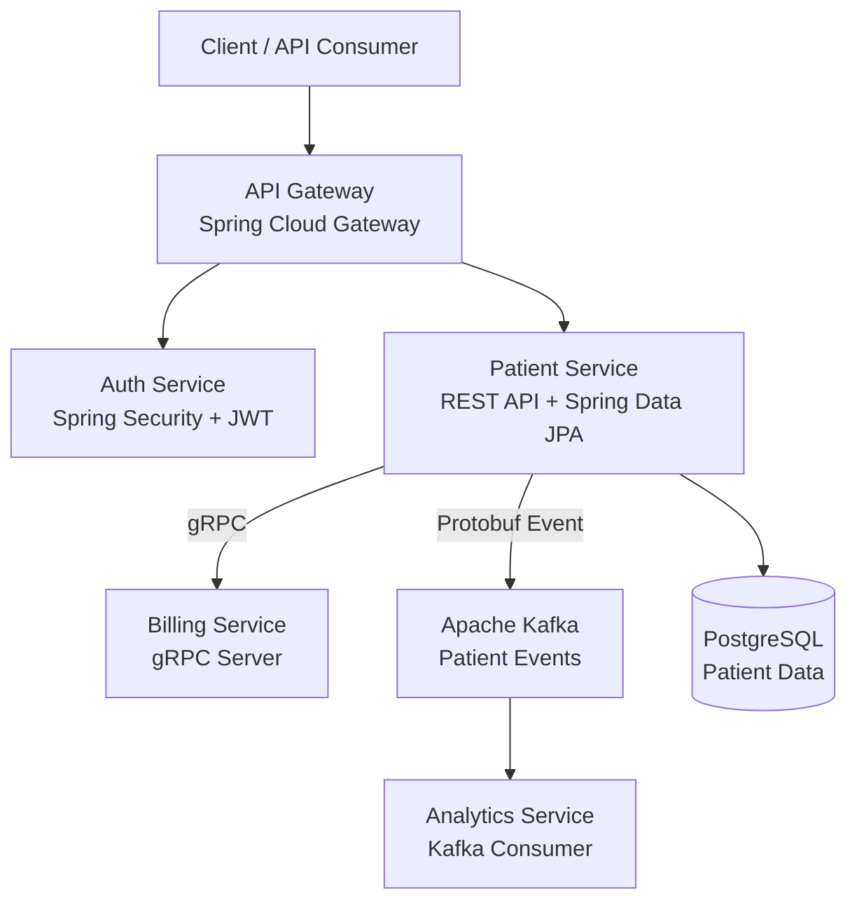
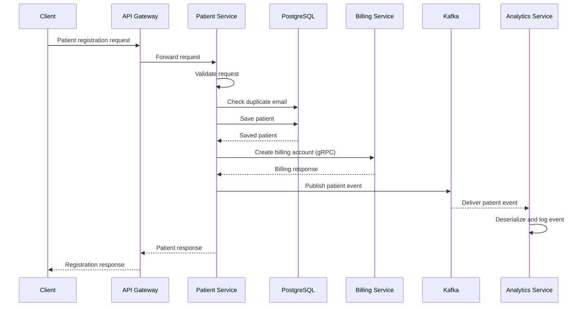

# Patient Management System

### A Microservices-Based Backend Application Built with Spring Boot

A distributed patient management backend demonstrating microservice architecture, service-to-service communication, JWT authentication, synchronous gRPC calls, and asynchronous event-driven messaging with Apache Kafka.

[](https://www.java.com/)
[](https://spring.io/projects/spring-boot)
[](https://www.postgresql.org/)
[](https://kafka.apache.org/)
[](https://grpc.io/)

---

## Overview

The Patient Management System is a backend application organized into independently structured Spring Boot services. It separates patient management, authentication, billing, and analytics responsibilities.

The system demonstrates two different communication approaches:

- **Synchronous communication:** gRPC is used by the Patient Service to communicate with the Billing Service.
- **Asynchronous communication:** Apache Kafka is used to publish patient events that are consumed by the Analytics Service.

An API Gateway provides a centralized entry point and includes custom JWT validation.

The project focuses on understanding distributed backend architecture, service boundaries, API security, and communication between independently deployable services.

## Architecture



*Conceptual architecture based on the implemented service components and communication code.*

## Services and Responsibilities

| Service | Responsibility | Technologies |
|---|---|---|
| API Gateway | Centralized routing and custom JWT validation | Spring Cloud Gateway, WebClient |
| Auth Service | User authentication and JWT generation | Spring Security, JWT |
| Patient Service | Patient registration, retrieval, updating and deletion | Spring Boot, JPA, PostgreSQL |
| Billing Service | Exposes billing account operations through gRPC | gRPC, Protocol Buffers |
| Analytics Service | Consumes patient events from Kafka | Apache Kafka, Protobuf |
| Infrastructure | Infrastructure definitions and LocalStack deployment support | AWS CDK |
| Integration Tests | Integration testing for authentication and patient workflows | JUnit, Spring Boot Test |

## Key Engineering Concepts

### 1. Microservices Architecture

The application separates business responsibilities into individual services rather than implementing everything inside a single monolithic application.

Each service has its own application entry point and Maven configuration.

### 2. API Gateway and JWT Authentication

The API Gateway acts as the entry point for client requests.

The Auth Service handles authentication and JWT generation. A custom gateway filter validates JWTs before allowing protected requests to proceed.

This demonstrates centralized request routing and token-based authentication.

### 3. Synchronous Communication with gRPC

The Patient Service communicates with the Billing Service using gRPC.

The communication contract is defined using Protocol Buffers (`.proto` files).

This demonstrates:
- Contract-based service communication.
- Strongly typed request and response messages.
- gRPC client and server integration.
- Communication between independently running services.

### 4. Asynchronous Communication with Apache Kafka

The Patient Service publishes patient events using Kafka.

The Analytics Service consumes events from the `patient` topic and deserializes the messages using Protocol Buffers.

This demonstrates event-driven communication and decoupling between the producer and consumer services.

### 5. Database and Persistence

The Patient Service uses Spring Data JPA and PostgreSQL for patient persistence.

The application uses DTOs and a mapper to separate API request/response structures from the persistence model.

### 6. Validation and Exception Handling

The Patient Service includes:
- Request validation.
- Duplicate email detection.
- Patient-not-found handling.
- Centralized exception handling.
- Separate request and response DTOs.

## Patient Registration Workflow



*The sequence represents the current implementation order. The Analytics Service currently logs the consumed event; it does not yet implement a full analytics pipeline.*

## Technology Stack

| Category | Technologies |
|---|---|
| Language | Java 21 |
| Backend Framework | Spring Boot |
| API Gateway | Spring Cloud Gateway |
| Security | Spring Security, JWT |
| Database | PostgreSQL, Spring Data JPA, Hibernate |
| Synchronous Communication | gRPC, Protocol Buffers |
| Asynchronous Messaging | Apache Kafka |
| Build Tool | Maven |
| Testing | JUnit, Spring Boot Test |
| Infrastructure | AWS CDK, LocalStack support |
| API Testing | HTTP request collections |

## Project Structure

```text
patient-management/
│
├── api-gateway/
├── auth-service/
├── patient-service/
├── billing-service/
├── analytics-service/
│
├── infrastructure/
├── integration-tests/
│
├── api-requests/
├── grpc-requests/
│
└── README.md
```

## Running the Project

### Prerequisites

- Java 21
- Maven
- PostgreSQL
- Apache Kafka
- Git

### Clone the repository

```bash
git clone https://github.com/Shubhamadane009/patient-management.git

cd patient-management
```

### Start the supporting infrastructure

Configure PostgreSQL and Kafka according to the individual service configuration files.

Ensure that the required databases, credentials, and service endpoints are configured before starting the applications.

### Build and run individual services

Each service contains its own `pom.xml` and Maven wrapper.

For example:

```bash
cd patient-service

./mvnw clean install

./mvnw spring-boot:run
```

Repeat the process for the other services after configuring their dependencies and required environment variables.

**Note:** The services depend on one another. Configure their ports, database connections, Kafka broker and gRPC endpoints consistently before running the complete application.

## Testing

The repository contains:
- Unit/application test modules within the services.
- Patient integration tests.
- Authentication integration tests.

The `integration-tests` module contains tests for patient and authentication workflows.

## Current Implementation Scope

This project is actively developed as a learning and engineering portfolio project.

Some components are intentionally at an early implementation stage:

- Billing gRPC currently demonstrates the service contract and returns a sample response.
- Analytics currently consumes and logs patient events; advanced analytics processing is not implemented.
- Infrastructure contains AWS CDK and LocalStack support code.

These limitations are documented to distinguish implemented functionality from future enhancements.

## Future Improvements

- Implement persistent billing account management.
- Add meaningful analytics processing and reporting.
- Introduce centralized configuration management.
- Add service health checks and observability.
- Improve distributed failure handling and retry strategies.
- Expand integration and end-to-end test coverage.
- Add automated CI/CD pipelines.

## What This Project Demonstrates

This project explores practical backend engineering concepts:

- Designing services around separate business responsibilities.
- Securing APIs using JWT authentication.
- Choosing between synchronous and asynchronous communication.
- Defining service contracts using Protocol Buffers.
- Publishing and consuming Kafka events.
- Implementing persistence and validation using Spring Data JPA.
- Testing interactions across backend services.

---


## Technical Documentation

Explore the architecture and engineering decisions behind this project.

| Document | Description |
|---|---|
| [System Architecture](docs/architecture.md) | High-level architecture, service responsibilities and communication |
| [Authentication Flow](docs/authentication-flow.md) | JWT generation, validation and API Gateway security |
| [Patient Registration Workflow](docs/patient-registration-flow.md) | End-to-end registration flow across services |
| [gRPC vs Kafka](docs/grpc-vs-kafka.md) | Synchronous RPC vs asynchronous event-driven communication |

### Key Engineering Topics

- Microservices architecture and separation of responsibilities
- JWT-based authentication and API Gateway security
- Synchronous inter-service communication using gRPC
- Asynchronous messaging using Apache Kafka
- Database persistence using PostgreSQL and Spring Data JPA
- Distributed system failure handling and consistency considerations


**Author:** Shubham Madane

**GitHub:** [Shubhamadane009](https://github.com/Shubhamadane009)

**Repository:** [Patient Management System](https://github.com/Shubhamadane009/patient-management)
