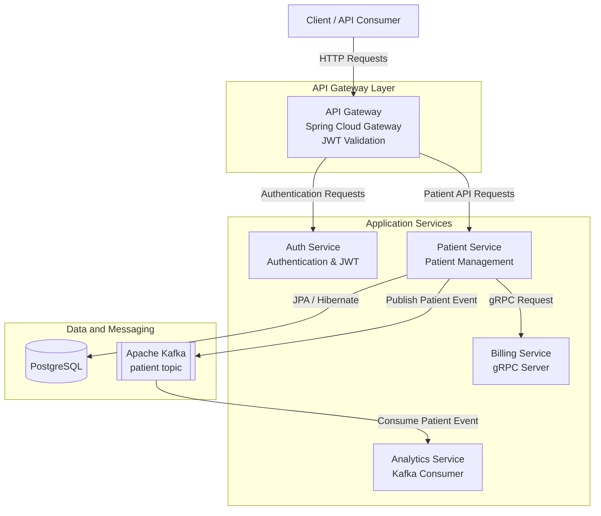

# System Architecture

## Patient Management System

This document describes the high-level architecture of the Patient Management System and the communication between its backend services.

## 1. High-Level Architecture

## 2. Service Responsibilities

| Component | Responsibility |
|---|---|
| API Gateway | Centralized entry point, request routing and JWT validation |
| Auth Service | Authentication and JWT generation |
| Patient Service | Patient business operations and database persistence |
| Billing Service | Exposes billing operations through a gRPC server |
| Analytics Service | Consumes patient events from Kafka |
| PostgreSQL | Stores patient data |
| Apache Kafka | Provides asynchronous event communication |

## 3. Communication Patterns

### REST – Client to Backend

Client requests enter through the API Gateway, which routes requests to the relevant application service.

### gRPC – Patient Service to Billing Service

The Patient Service uses a gRPC client to communicate with the Billing Service.

Protocol Buffers define the service contract and message structures.

### Kafka – Patient Service to Analytics Service

The Patient Service publishes patient events to Kafka.

The Analytics Service consumes events from the `patient` topic.

This allows the event producer and consumer to communicate asynchronously.

## 4. Architectural Design Principles

**Separation of Responsibilities**

Each service has a distinct responsibility, keeping authentication, patient management, billing and analytics concerns separate.

**Independent Service Components**

Services have separate application configurations and build definitions.

**Synchronous and Asynchronous Communication**

The system uses gRPC when a direct service response is required and Kafka for asynchronous event delivery.

**Centralized API Entry Point**

The API Gateway provides a common entry point for external API requests and performs JWT validation.

## 5. Important Implementation Notes

- Patient data persistence is implemented using Spring Data JPA and PostgreSQL.
- Billing communication currently demonstrates a gRPC contract with a sample response.
- Analytics currently consumes and logs Kafka events.
- The diagram represents the implemented service relationships, not a claim that every business workflow is production-complete.

---

**Project:** Patient Management System

**Technology:** Java, Spring Boot, PostgreSQL, gRPC, Apache Kafka and Spring Cloud Gateway
