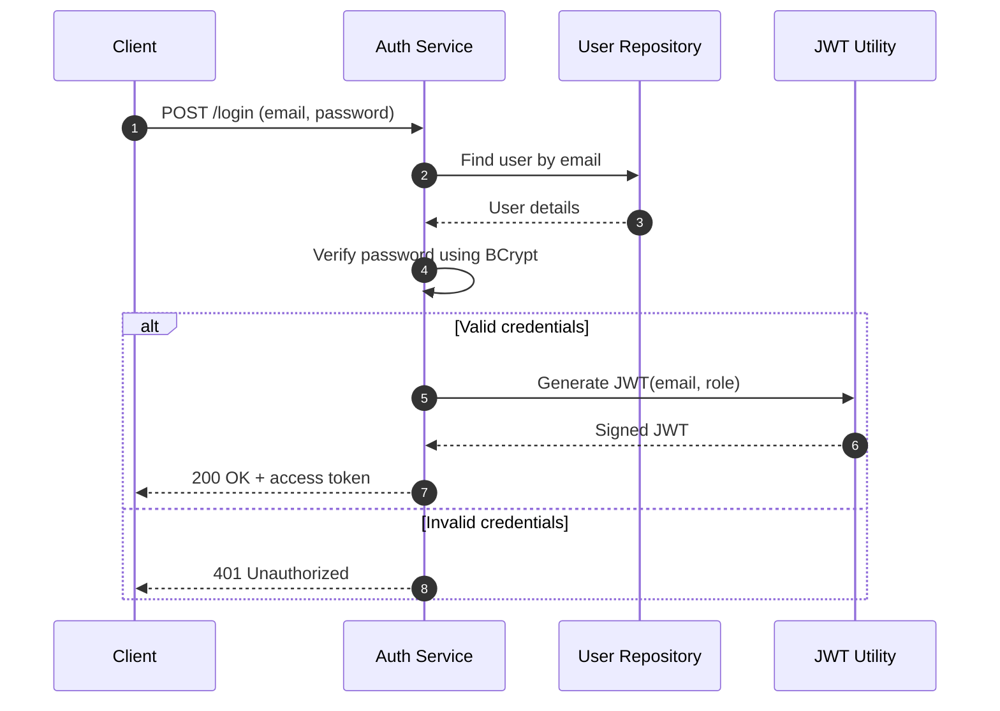
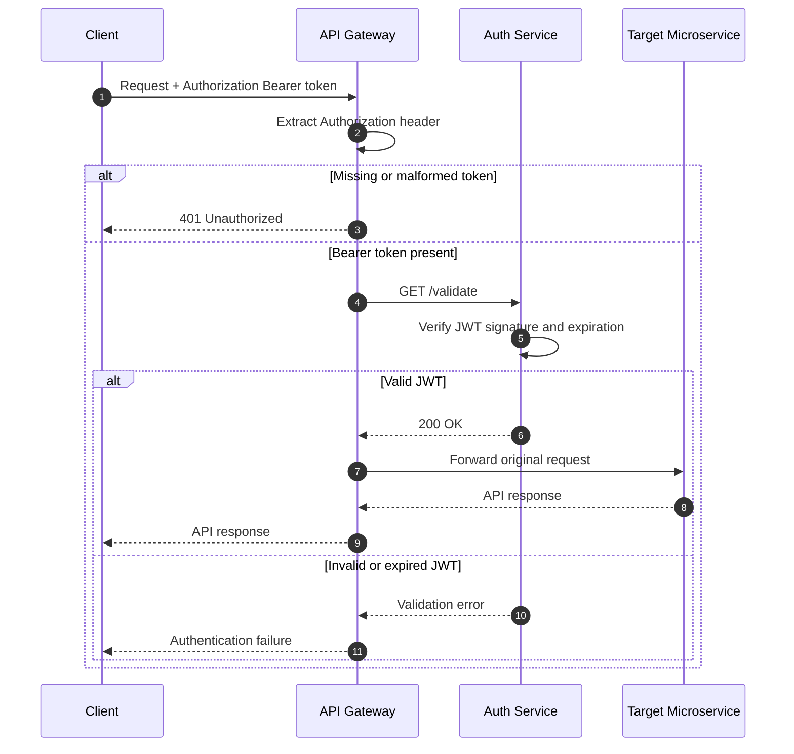

# JWT Authentication and Authorization Flow

## Overview

The application uses JSON Web Tokens (JWT) to authenticate users and protect API requests through a centralized API Gateway.

The Auth Service is responsible for authenticating credentials and generating signed JWT tokens. The API Gateway validates incoming tokens by communicating with the Auth Service.

## 1. Login Flow

## 2. Protected API Request Flow

## 3. JWT Structure

The token generated by the Auth Service contains:

| Claim | Purpose |
|---|---|
| Subject | User email |
| Role | User role |
| Issued At | Token creation timestamp |
| Expiration | Token expiry timestamp |

The token is signed using an HMAC-based secret key.

The configured token lifetime in the current implementation is 10 hours.

## 4. Password Security

Passwords are verified using Spring Security's `BCryptPasswordEncoder`.

During authentication, the application:
1. Retrieves the user using the supplied email.
2. Compares the supplied password against the stored BCrypt hash.
3. Generates a JWT only when the password matches.

## 5. Responsibilities of Each Component

| Component | Responsibility |
|---|---|
| Auth Controller | Exposes login and token-validation endpoints |
| Auth Service | Coordinates credential authentication and token validation |
| User Service | Retrieves users by email |
| User Repository | Accesses user records |
| Password Encoder | Verifies passwords using BCrypt |
| JWT Utility | Generates and validates signed tokens |
| API Gateway Filter | Extracts Bearer tokens and calls Auth Service |

## 6. Important Implementation Notes

- The Gateway checks for a Bearer token before forwarding protected requests.
- Token validation is performed by the Auth Service through the `/validate` endpoint.
- The Gateway forwards the original request only after successful validation.
- The JWT includes a role claim, but the current Gateway filter validates the token rather than enforcing role-based authorization.
- The Auth Service security configuration currently permits all requests at the Spring Security filter-chain level; application-level authentication is performed by the login endpoint.

## 7. Potential Improvements

- Add role-based authorization for protected endpoints.
- Add refresh-token support and token revocation.
- Use environment-managed secrets and rotate signing keys.
- Add rate limiting to authentication endpoints.
- Add consistent error handling for downstream Auth Service failures.
- Consider local JWT verification at the Gateway to avoid a validation network call on every protected request, with appropriate key-management and revocation trade-offs.

---

**Project:** Patient Management System

**Security Stack:** Spring Security, BCrypt, JWT, Spring Cloud Gateway
