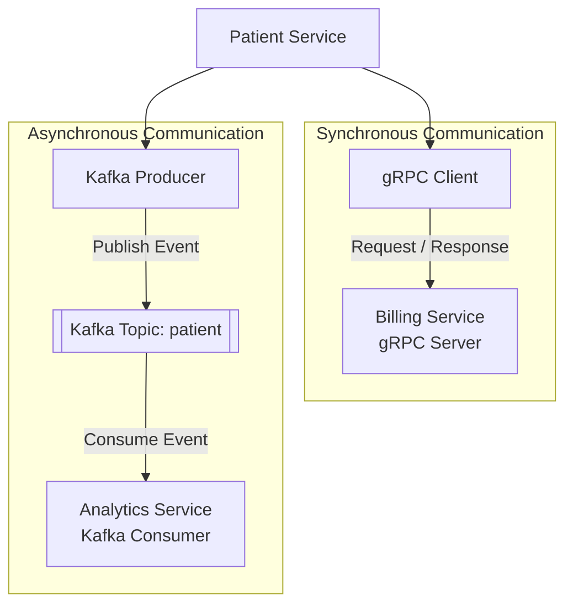

# gRPC vs Apache Kafka: Communication Design

## Overview

The Patient Management System uses two different service-to-service communication patterns:

- **gRPC:** Synchronous communication between Patient Service and Billing Service.
- **Apache Kafka:** Asynchronous event-driven communication between Patient Service and Analytics Service.

Both approaches solve different problems in a distributed backend system.

## 1. Communication Architecture

## 2. gRPC: Synchronous Communication

### Implementation in this project

The Patient Service uses a gRPC client to invoke the Billing Service.

The communication contract is defined using Protocol Buffers.

The flow is:

1. Patient Service creates a billing account request.
2. The gRPC client sends the request to Billing Service.
3. Billing Service processes the request.
4. Billing Service returns a response.
5. Patient Service receives the response and continues its workflow.

### Why gRPC?

- Strongly typed service contracts.
- Efficient Protocol Buffers serialization.
- Direct request-response communication.
- Suitable when a service needs an immediate response from another service.

### Trade-offs

The calling service waits for the response. If the downstream service is unavailable or slow, the calling workflow can be delayed or fail.

## 3. Apache Kafka: Asynchronous Communication

### Implementation in this project

The Patient Service publishes patient events to the Kafka topic:

`patient`

The Analytics Service consumes these events using a Kafka listener.

The flow is:

1. Patient Service creates a patient event.
2. The event is serialized using Protocol Buffers.
3. The Kafka producer publishes the event.
4. Kafka makes the event available to consumers.
5. Analytics Service receives and deserializes the event.
6. The current consumer logs the received event.

### Why Kafka?

- Producer and consumer do not need to communicate directly.
- Event processing is decoupled from the producer's request flow.
- Events can be consumed independently.
- Kafka supports scalable event-driven architectures.

### Trade-offs

Asynchronous messaging introduces additional considerations:

- Duplicate event delivery and idempotency.
- Consumer failures and retries.
- Event ordering.
- Message serialization and schema compatibility.
- Eventual consistency between services.

## 4. gRPC vs Kafka

| Feature | gRPC | Apache Kafka |
|---|---|---|
| Communication | Synchronous | Asynchronous |
| Model | Request-response | Publish-subscribe |
| Response | Direct response | No immediate consumer response |
| Contract | Protocol Buffers | Message/event schema |
| Coupling | Caller depends on service availability | Producer and consumer are decoupled |
| Typical use | Direct service operations | Event distribution |
| Failure considerations | Timeouts and retries | Consumer retries and duplicate handling |

## 5. Why This Project Uses Both

The project uses each technology for a different communication requirement.

**Patient Service → Billing Service: gRPC**

The Patient Service invokes Billing Service and receives a response as part of its registration workflow. This is a request-response interaction.

**Patient Service → Analytics Service: Kafka**

The Patient Service publishes a patient-created event. Analytics Service consumes it independently, without requiring the Patient Service to wait for analytics processing.

This separation demonstrates how synchronous and asynchronous communication can coexist in a microservices architecture.

## 6. Important Engineering Considerations

### What happens if Billing Service is unavailable?

The synchronous gRPC call may fail or time out. The Patient Service needs suitable timeout and error-handling policies.

### What happens if Analytics Service is unavailable?

Kafka can retain published messages for later consumption, subject to topic retention and consumer configuration.

### What happens if a Kafka event is processed twice?

Consumers should implement idempotent processing to avoid duplicate side effects.

### What happens if patient persistence succeeds but event publishing fails?

The database and Kafka operations are not one atomic transaction in the current implementation. The Transactional Outbox Pattern is a possible improvement.

## 7. Future Improvements

- Implement gRPC deadlines and retry policies.
- Introduce Kafka retry and dead-letter topic handling.
- Add consumer idempotency.
- Introduce schema evolution and compatibility checks.
- Implement the Transactional Outbox Pattern.
- Add distributed tracing across service boundaries.

---

**Project:** Patient Management System

**Communication Technologies:** gRPC, Protocol Buffers, Apache Kafka

**Core Concepts:** Synchronous RPC, Event-Driven Architecture, Distributed Systems, Eventual Consistency
