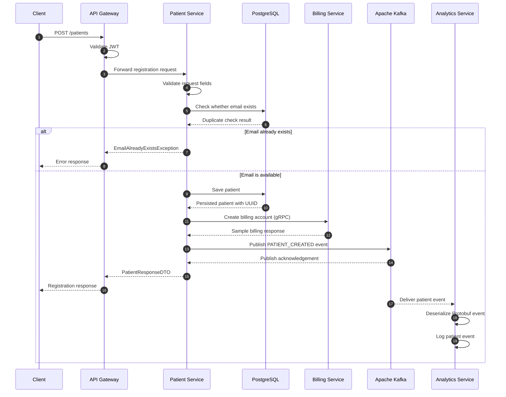

# Patient Registration Workflow

## Overview

This document explains how a patient registration request moves through the Patient Management System.

The workflow demonstrates:
- REST API request handling.
- Request validation and duplicate-email checks.
- Patient persistence using Spring Data JPA.
- Synchronous communication with Billing Service using gRPC.
- Asynchronous event publishing using Apache Kafka.

## 1. End-to-End Registration Flow

## 2. Step-by-Step Execution

### Step 1: API Request

The client sends a POST request to:

`POST /patients`

The request contains:
- Patient name
- Email
- Address
- Date of birth
- Registration date

The request is routed through the API Gateway.

### Step 2: Request Validation

The Patient Controller receives the request and applies Bean Validation.

The application checks required fields, email format and field constraints.

### Step 3: Duplicate Email Check

Before creating a patient, the Patient Service calls:

`patientRepository.existsByEmail(email)`

If the email already exists, an `EmailAlreadyExistsException` is thrown.

### Step 4: Persist Patient Data

The request DTO is converted into a Patient entity using `PatientMapper`.

The entity is saved using:

`patientRepository.save(patient)`

PostgreSQL stores the patient record and generates its UUID.

### Step 5: Synchronous gRPC Communication

After saving the patient, the Patient Service invokes:

`billingServiceGrpcClient.createBillingAccount(...)`

The Billing Service receives the gRPC request.

The current Billing Service implementation returns a sample response to demonstrate the gRPC contract.

### Step 6: Publish Kafka Event

The Patient Service creates a `PatientEvent` using Protocol Buffers.

The event includes:
- Patient ID
- Patient name
- Patient email
- Event type: `PATIENT_CREATED`

The serialized event is published to the Kafka topic:

`patient`

### Step 7: Consume Kafka Event

The Analytics Service listens to the `patient` topic using `@KafkaListener`.

It deserializes the Protobuf message and currently logs the received patient information.

### Step 8: Return API Response

The Patient Service converts the saved entity into a `PatientResponseDTO` and returns it to the API Gateway, which forwards the response to the client.

## 3. Communication Patterns

| Interaction | Communication | Purpose |
|---|---|---|
| Client → Gateway | HTTP/REST | External API access |
| Gateway → Patient Service | HTTP/REST | Patient operations |
| Patient → PostgreSQL | JPA | Patient persistence |
| Patient → Billing | gRPC | Synchronous billing account request |
| Patient → Kafka | Kafka Producer | Publish patient-created event |
| Kafka → Analytics | Kafka Consumer | Asynchronous event consumption |

## 4. Engineering Considerations

### Synchronous vs Asynchronous Communication

The Billing Service call uses synchronous gRPC communication. The Patient Service waits for its response.

Kafka provides asynchronous event delivery. The Analytics Service processes the event independently.

### Failure Handling

The current implementation does not provide a distributed transaction across PostgreSQL, gRPC and Kafka.

For example, the patient is saved before the Billing Service and Kafka operations are invoked. A downstream failure can therefore leave the patient record persisted without all subsequent operations completing.

### Potential Improvements

- Introduce the Transactional Outbox Pattern for reliable event publishing.
- Add retry and timeout policies for gRPC calls.
- Add idempotent event consumption.
- Implement meaningful billing account persistence.
- Add dead-letter topic handling for failed Kafka messages.
- Add integration tests for downstream service failures.

---

**Project:** Patient Management System

**Core Concepts:** REST, Spring Data JPA, PostgreSQL, gRPC, Protocol Buffers, Apache Kafka
